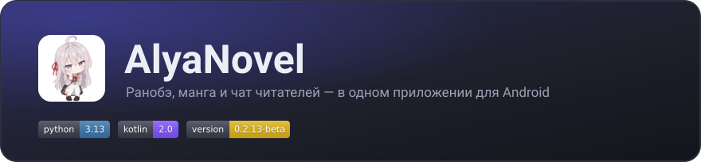
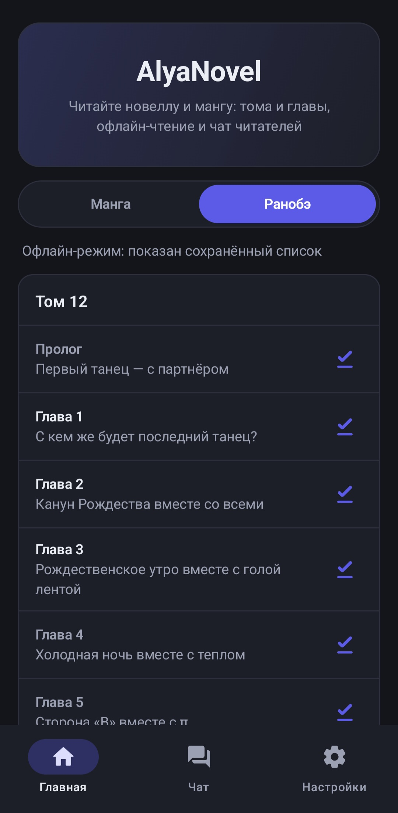
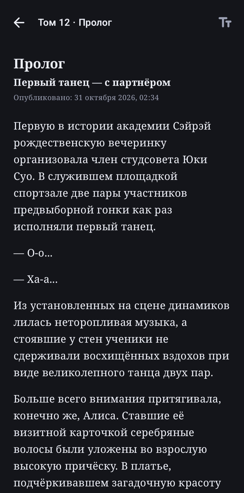
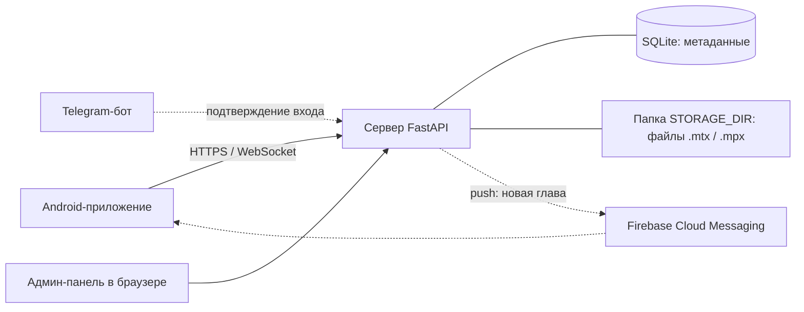
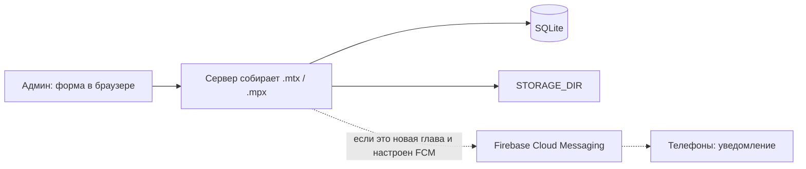
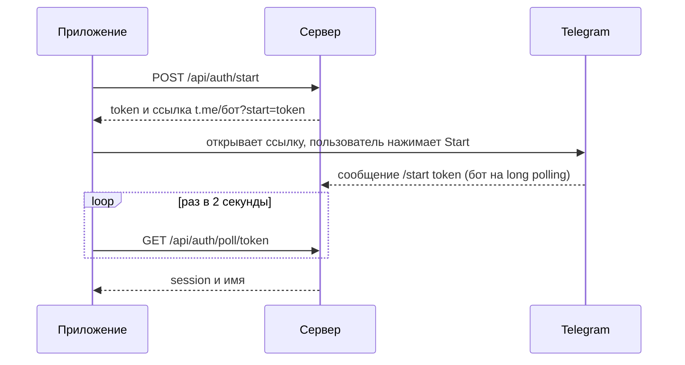

<p align="center">
  
</p>

<p align="center">
  <b>Читалка ранобэ и манги для Android с чатом читателей.</b><br>
  Бесплатно · без рекламы · можно читать без интернета
</p>

<p align="center">
  <a href="#часть-1-о-приложении">О приложении</a> ·
  <a href="#часть-2-техническая-часть">Техническая часть</a>
</p>

<p align="center"> </p>

---

# Часть 1. О приложении

## Что это

**AlyaNovel** — приложение для Android, в котором читают новеллу (ранобэ) и мангу *"Аля иногда кокетничает со мной по русски"* в переводе Команды Telegram-канала alya_novel.
Тома и главы, пролог, эпилог и дополнительные главы лежат в одном месте и открываются сразу. Любую главу можно скачать и читать без интернета,
а рядом работает чат, где можно обсудить прочитанное.

Приложение бесплатное, без рекламы и без обязательной регистрации.

## История появления

Всё началось с шутки в чате Telegram-канала. Один из администраторов написал:

> зачем нужны эти ваши mangalib, ranobelib, делаем alyalib

Я решил ответить на это не словами, а делом. Так появилось приложение, а чуть позже — и его название: **AlyaNovel**. Это «свой lib» для нашего перевода:
со своим сайтом, чатом и читалкой, которая сделана под то, что мы читаем.

## Что умеет

- **Манга и ранобэ** — два раздела, переключаются одним касанием.
- **Тома и главы** в правильном порядке: пролог, главы, эпилог и «экстры» — дополнительные главы вне рамок сюжета. Новые главы появляются в списке, как только мы их выложили.
- **Удобное чтение.** Прямо в читалке меняются шрифт (без засечек, с засечками, моноширинный), размер текста и межстрочный интервал. Есть ползунок быстрой прокрутки, отметки «прочитано» и кнопки «Предыдущая / Следующая глава». В ранобэ встречаются иллюстрации, манга читается лентой страниц.
- **Офлайн.** Скачайте главы заранее и читайте без интернета. Можно разрешить загрузку только по Wi-Fi.
- **Чат читателей.** Вход через Telegram, без паролей: приложение открывает бота, вы нажимаете Start и возвращаетесь. Пока что отключено (не проходило проверку и требует доработки)
- **Уведомления о новых главах.**
- **Тёмная и светлая тема**, оформление в стиле сайта проекта.

## Как установить

1. Скачайте APK-файл: кнопка «Скачать» на сайте проекта, или в Releases.
2. Разрешите установку из этого источника — Android спросит сам.
3. Откройте приложение, примите условия использования и (по желанию) разрешите уведомления.

Нужен Android 8.0 или новее. Обновления: **Настройки → О приложении → Проверить обновления**.

> Версия **0.2.13-beta** — ранняя: возможны ошибки. О проблемах и идеях пишите в чат канала.

## Частые вопросы

**Нужна ли регистрация?** Нет. Читать можно без аккаунта, для чата нужен вход через Telegram.

**Это платно?** Нет. Проект некоммерческий. Он может жить на добровольные пожертвования, но они не открывают никаких платных функций.

**Какие данные вы храните?** Для чата — ваш Telegram ID, имя, username и сообщения; технические данные запросов к серверу. Подробности — в политике конфиденциальности ([файл](server/legal/privacy.md), она же на сайте).

**Чьи это материалы?** Это неофициальный любительский перевод. Права на оригинальное произведение принадлежат правообладателям; поддержите авторов покупкой официальных изданий там, где они доступны.

Документы: [Пользовательское соглашение](server/legal/tos.md) · [Политика конфиденциальности](server/legal/privacy.md)

Лицензия исходного кода: [Apache 2.0](LICENSE.md)

---

# Часть 2. Техническая часть

## Из чего состоит проект

| Часть | Что делает | Стек |
|---|---|---|
| **Приложение** | Каталог, читалка, офлайн, чат, уведомления | Kotlin 2.0, Jetpack Compose, Material 3, OkHttp, Coil, DataStore, WorkManager |
| **Сервер** | API, хранение глав, вход через Telegram, чат, сайт, админ-панель | Python 3.13, FastAPI, SQLite, Jinja2 |
| **Форматы `.mtx` / `.mpx`** | Контейнеры глав: текст ранобэ и страницы манги с метаданными | ZIP + `manifest.json` |
| **Telegram-бот** | Подтверждает вход в приложение | работает внутри сервера (long polling) |
| **Firebase Cloud Messaging** *(необязательно)* | Мгновенные уведомления о новых главах | FCM HTTP v1, тема `new_chapters` |



## Как всё работает

### Публикация главы
Админ открывает `/admin`, выбирает том и **тип главы** (глава, пролог, эпилог, экстра) и загружает материал: текст для ранобэ или картинки для манги.
Сервер собирает файл (`.mtx` или `.mpx`), кладёт его в папку `STORAGE_DIR` под кодом этой главы, а в SQLite записывает метаданные. Если Firebase настроен —
отправляет в тему `new_chapters` одно сообщение, и устройства получают уведомление сразу.



### Чтение
Приложение запрашивает `GET /api/{manga|ranobe}/volumes` и показывает тома и главы (список кэшируется на диск — он виден и офлайн). При открытии главы файл
скачивается один раз в `filesDir/chapters/<id>_<size>.<fmt>` и дальше читается локально. Размер в имени файла — признак версии: заменили главу на сервере,
и приложение перекачает её само. Длинный текст ранобэ разбит на части, поэтому читалка показывает начало сразу, пока дочитываются остальные. Распакованные
страницы и иллюстрации лежат в кэше (`cacheDir/pages`), его можно очистить в настройках.

### Вход через Telegram (пока что не работает)



Сессия хранится в приложении (DataStore) и передаётся как `Authorization: Bearer …` в REST и как `?token=` в WebSocket.

### Чат
WebSocket `/ws/chat`: клиент шлёт текст, сервер сохраняет сообщение и рассылает всем подключённым. История — `GET /api/chat/messages`. Соединение живёт, пока приложение на экране;
при обрыве приложение переподключается с нарастающей паузой. О новых сообщениях на других вкладках говорит значок.

### Уведомления о новых главах
Два пути, которые не дублируют друг друга:
1. **Мгновенный push (FCM).** Приложение подписано на тему, сервер при публикации новой главы шлёт data-сообщение с высоким приоритетом, уведомление рисует приложение
   (с учётом переключателя в настройках).
2. **Запасной путь.** WorkManager раз в ~15 минут спрашивает `GET /api/latest?since=…` — на телефонах без сервисов Google и при сбоях.

Дубли исключает отметка «последнее виденное»: каждый путь двигает её вперёд. Замена существующей главы «новой главой» не считается.

## Форматы глав

Оба формата — обычные ZIP-архивы с `manifest.json` в корне.

```
.mtx (ранобэ, версия 4)             .mpx (манга, версия 1)
├─ manifest.json                    ├─ manifest.json
├─ 0001.txt, 0002.txt, …            └─ pages/
└─ images/0001.jpg, …  (по желанию)    ├─ 0001.jpg
                                       └─ 0002.png …
```

```json
{
  "format": "mtx", "version": 4,
  "title": "Пролог", "volume": 1, "chapter": 0,
  "type": "prologue", "code": "R01-P",
  "parts": ["0001.txt", "0002.txt"], "images": [], "part_bytes": 32768,
  "created": 1792712832
}
```

- **Части текста.** Текст режется на `0001.txt`, `0002.txt`… по размеру (по умолчанию 32 КБ) строго по границам строк; склейка частей даёт исходный текст дословно.
- **Иллюстрации** в тексте — отдельная строка ``, где `N` — номер файла из `images`. Картинки можно вставлять ссылками (postimg.cc, imgur.com): сервер сам скачивает их и кладёт внутрь файла.
- **Типы глав и коды файлов:** пролог `R01-P`, глава `R01-03`, эпилог `R01-E`, экстра `R01-A01` (`M…` вместо `R` — для манги). Порядок в томе: пролог → главы → эпилог → экстра.
- **Версии.** Версия `.mtx` — 4 (иллюстрации необязательны, глава может быть просто текстом); старые версии 1-3 читаются как раньше. Файл новее, чем знает клиент, приложение
  не открывает, а просит обновиться.

Полное описание API и форматов — в [/docs/PROTOCOL.md](docs/PROTOCOL.md).

### Картинки по ссылкам
В тексте главы: `` или просто ссылка отдельной строкой — прямая или на страницу одной картинки. Сервер скачивает файлы при сохранении главы.
Защита от злоупотреблений (сервер ходит по ссылкам, которые вводит человек): только `https`, только хосты из белого списка `IMAGE_HOSTS`, проверка каждого редиректа, только публичные IP,
проверка содержимого по сигнатуре (JPEG, PNG, WEBP), лимиты на размер файла, число картинок и суммарный объём. Альбомы imgur не поддерживаются — только отдельные картинки.

## Сервер

**Данные.** SQLite: `volumes`, `chapters` (тип, номер, формат, имя файла, размер), `admins`, `users`, `sessions`, `auth_requests`, `messages`.
Сами файлы глав лежат на диске в `STORAGE_DIR` — в базе только имя файла. **Бэкап = файл базы + папка `STORAGE_DIR`.**
Уникальность главы — `(том, тип, номер)`; старые базы переводятся на актуальную схему автоматически при запуске.

**Безопасность.** Пароли администраторов хранятся в виде хешей PBKDF2-SHA256. Сессия админ-панели хранится в подписанной cookie с `SameSite=Strict` и сроком действия 8 часов. По умолчанию cookie не ограничена HTTPS: для публичного сайта включите `HTTPS_ONLY=1` и настройте HTTPS на reverse proxy. Обязательно задайте собственный случайный `SECRET_KEY` — значение по умолчанию `change-me` небезопасно. При смене ключа действующие cookie администраторов перестанут работать.

Токен для входа через Telegram действует 10 минут. Без `BOT_TOKEN` вход через Telegram отключён. Сервер выдаёт пользователю случайный токен сессии для запросов к API и подключения к чату.

При загрузке картинок по ссылкам сервер принимает только HTTPS-адреса с хостов из `IMAGE_HOSTS`, проверяет редиректы и формат файлов, ограничивает размер и количество картинок. При прямом подключении сервер проверяет, что адрес ведёт на публичный IP. <u>Не передавайте серверу ссылки, которым не доверяете</u>.

Храните `SECRET_KEY`, токен Telegram-бота и ключ Firebase вне репозитория. Для резервного копирования сохраните и файл базы данных, и каталог `STORAGE_DIR`.

**Исходящие соединения** (скачивание картинок, бот, Firebase) идут через `OUTBOUND_PROXY` или системный прокси; SOCKS-прокси приводится к `socks5h`.

**Сайт:** главная страница проекта с кнопкой «Скачать», страницы `/tos` и `/privacy` (из Markdown-файлов), `/download` (APK), `/admin`.

## Приложение

- **Архитектура:** Jetpack Compose + ViewModel + `StateFlow`; зависимости создаются вручную в `AppContainer` (без DI-фреймворка); навигация — Navigation Compose.
- **Слой форматов** (`formats/`) — чистый Kotlin без зависимостей: разбор ZIP и JSON, тесты запускаются на обычной JVM и используют файлы, созданные настоящим серверным кодом.
- **Хранение:** настройки и сессия — DataStore; главы — `filesDir/chapters`; кэш страниц — `cacheDir/pages`; последний список томов — JSON в `filesDir`.
- **Дизайн:** палитра и формы взяты с сайта проекта (светлая и тёмная тема, карточки с рамкой, «пилюли», градиентная шапка).
- **Минимальный Android:** 8.0 (API 26), `targetSdk` 35.

## Сборка и запуск

### Требования
- Python 3.13 (проект также проверялся на 3.12)
- JDK 17
- Android Studio (Ladybug или новее)
- Android SDK 35

### Сервер

```bash
python3.13 -m venv .venv
source .venv/bin/activate      # Windows: .venv\Scripts\activate
pip install -r requirements.txt

python -m server.db create-admin admin "сильный-пароль"

export BOT_TOKEN=...
export BOT_USERNAME=my_bot
export SECRET_KEY=$(python -c "import secrets; print(secrets.token_hex(32))")
export HTTPS_ONLY=1

uvicorn server.main:app --proxy-headers --forwarded-allow-ips 127.0.0.1 --host 127.0.0.1 --port 8000
```

В Windows PowerShell переменные задаются так: `$env:BOT_TOKEN="..."`. Админ-панель: `https://ваш-домен/admin`.

Перед `uvicorn` нужен reverse proxy с HTTPS. Пример для Caddy (WebSocket работает «из коробки»):

```
alya.example.com {
    reverse_proxy 127.0.0.1:8000
}
```

Для nginx нужны заголовки `Upgrade` / `Connection` для `/ws/` и увеличенный `client_max_body_size` (главы манги бывают тяжёлыми).

| Переменная | По умолчанию | Назначение |
|---|---|---|
| `SECRET_KEY` | `change-me` | Ключ подписи сессий админ-панели. Для публичного сервера задайте собственный случайный ключ |
| `HTTPS_ONLY` | `0` | Установите `1`, чтобы cookie админ-панели передавалась только по HTTPS |
| `BOT_TOKEN` | — | Токен Telegram-бота; без него вход через Telegram отключён |
| `BOT_USERNAME` | `your_bot` | Имя Telegram-бота без `@`; задайте настоящее имя, если настроен `BOT_TOKEN` |
| `DB_PATH` | `alyanovel.db` | Путь к файлу SQLite |
| `STORAGE_DIR` | `storage/chapters` | Каталог с файлами глав `.mtx` и `.mpx` |
| `MTX_PART_KB` | `32` | Размер части текста ранобэ в `.mtx`, в килобайтах |
| `APP_LATEST_VERSION` | `0.1.0` | Последняя версия приложения для проверки обновлений |
| `APK_PATH` | — | Путь к APK на сервере; если файл существует, `/download` отдаёт его |
| `APP_DOWNLOAD_URL` | — | Внешняя ссылка для скачивания APK; используется, если APK не задан через `APK_PATH` |
| `PUBLIC_URL` | — | Публичный адрес сайта, например `https://alya.example.com`; используется для ссылки на APK при проверке обновлений |
| `IMAGE_HOSTS` | `postimg.cc,imgur.com` | Разрешённые домены для ссылок на картинки, через запятую |
| `IMAGE_MAX_MB` | `8` | Максимальный размер одной картинки в мегабайтах |
| `IMAGE_TOTAL_MAX_MB` | `60` | Максимальный суммарный размер картинок в главе в мегабайтах |
| `OUTBOUND_PROXY` | системные настройки | Прокси для исходящих запросов. Примеры: `http://127.0.0.1:10809`, `socks5://127.0.0.1:10808`; значение `none` отключает прокси |
| `FCM_SERVICE_ACCOUNT` | — | Путь к JSON-ключу сервисного аккаунта Firebase; оставьте пустым, чтобы отключить мгновенные push-уведомления |
| `FCM_TOPIC` | `new_chapters` | Тема Firebase Cloud Messaging для push-уведомлений |

Если `OUTBOUND_PROXY` не задана, сервер может использовать системные настройки прокси или переменные `HTTPS_PROXY`, `HTTP_PROXY` и `ALL_PROXY`. Для SOCKS-прокси нужен пакет `httpx[socks]`.

**Обязательные настройки для публичного сервера:** собственный `SECRET_KEY` и HTTPS с `HTTPS_ONLY=1`. `BOT_TOKEN` нужен только для входа через Telegram; настройки `FCM_*` — только для мгновенных push-уведомлений.

**Мгновенные push (необязательно).** Создайте проект в [Firebase Console](https://console.firebase.google.com), добавьте Android-приложение с пакетом `org.dedussamosval.alya`,
положите `google-services.json` в `alyanovel-app/app/`; в Project settings → Service accounts создайте приватный ключ, положите JSON на сервер и задайте `FCM_SERVICE_ACCOUNT`.
Проверка: `python -m server.push` — на телефон придёт тестовое уведомление. Без Firebase всё работает, новые главы проверяются по расписанию.

### Приложение

```bash
cd alyanovel-app
./gradlew installDebug                                              # debug на подключённое устройство или эмулятор
./gradlew assembleRelease -PserverUrl=https://alya.example.com      # release (нужна подпись)
```

- Адрес сервера задаётся в `gradle.properties`: `serverUrl` (release, только HTTPS) и `debugServerUrl` (по умолчанию `http://192.168.31.36:8000` — ваш компьютер из эмулятора (адрес можно посмотреть в настройках сети);
  для телефона по Wi-Fi укажите IP компьютера: `-PdebugServerUrl=http://192.168.1.50:8000`). В debug-сборке разрешён HTTP, в release — нет.
- Подпись релиза: Android Studio → **Build → Generate Signed App Bundle / APK**. Keystore в репозиторий не добавляйте.
- Версия: `versionName` и `versionCode` в `app/build.gradle.kts`; последнюю версию для проверки обновлений сообщайте серверу через `server/storage/download/version.txt` (рекомендуется) или `APP_LATEST_VERSION`.


## Структура репозитория

```
server/                  сервер: API, админ-панель, чат, бот, push, картинки, шаблоны, юридические тексты
common/                  общий код форматов .mtx / .mpx
alyanovel-app/       приложение (Kotlin, Compose)
  app/src/main/java/org/dedussamosval/alya/
    formats/             чтение .mtx/.mpx и JSON (без зависимостей)
    data/                API, хранилища, репозитории, чат-клиент, фоновые задачи, push
    ui/                  тема, компоненты, экраны: главная, читалка, чат, настройки, первый запуск
docs/    заголовок, описание протокола клиент ↔ сервер, инструкции для сайта
README.md    этот файл
LICENSE.md    лицензия Apache License v.2.0
CONTRIBUTING.md    инструкции для желающих помочь проекту
requirements.txt    зависимости Python 
```

## Версии и совместимость

| Что | Версия |
|---|---|
| Приложение | 0.2.13-beta |
| Формат `.mtx` | 4 (читаются 1 - 3) |
| Формат `.mpx` | 1 |
| Python / Kotlin | 3.13 / 2.0 |
| Android | от 8.0 (API 26) |

## Планы

- [x] Каталог, читалка ранобэ и манги, офлайн-чтение
- [x] Вход через Telegram и чат
- [x] Админ-панель, форматы `.mtx` / `.mpx`, части текста
- [x] Иллюстрации в ранобэ по ссылкам (postimg.cc, imgur.com)
- [x] Пролог, эпилог и экстра-главы
- [x] Мгновенные уведомления о новых главах (Firebase)
- [ ] Постраничный режим манги с учётом направления чтения
- [x] Запоминание места, где остановились
- [ ] Закладки в тексте
- [ ] Фоновые уведомления о сообщениях чата

---

> Licensed under the Apache License, Version 2.0 (the "License");
> you may not use this file except in compliance with the License.
> You may obtain a copy of the License at
> 
>   http://www.apache.org/licenses/LICENSE-2.0
> 
> Unless required by applicable law or agreed to in writing, software
> distributed under the License is distributed on an "AS IS" BASIS,
> WITHOUT WARRANTIES OR CONDITIONS OF ANY KIND, either express or implied.
> See the License for the specific language governing permissions and
> limitations under the License.

---

<p align="center">© 2026 DedusSamosval</p>